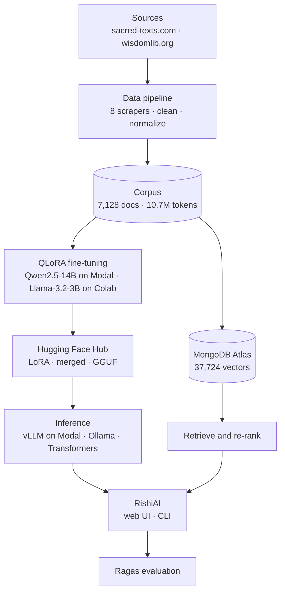
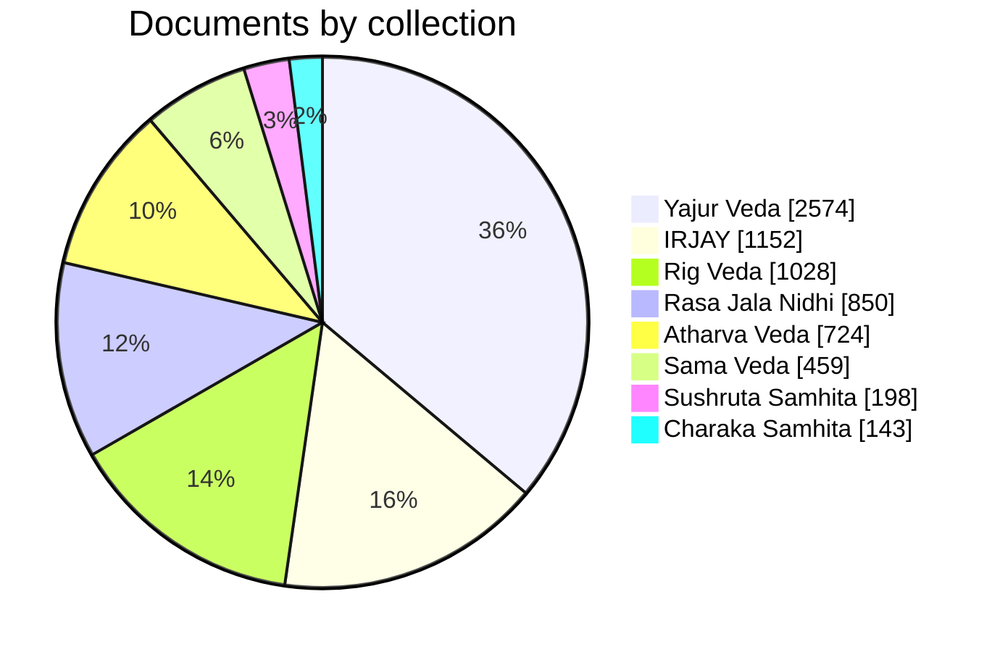
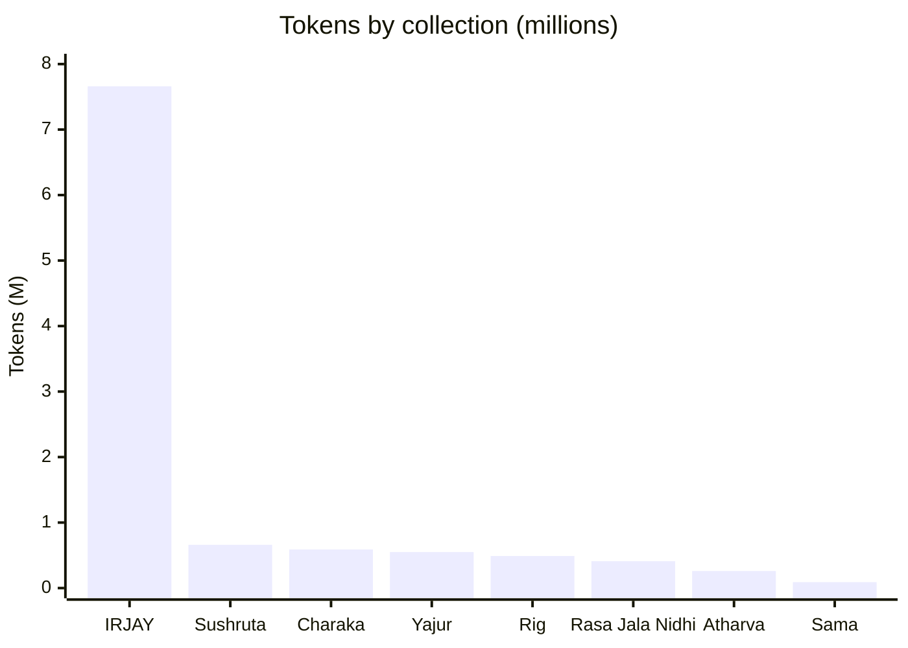
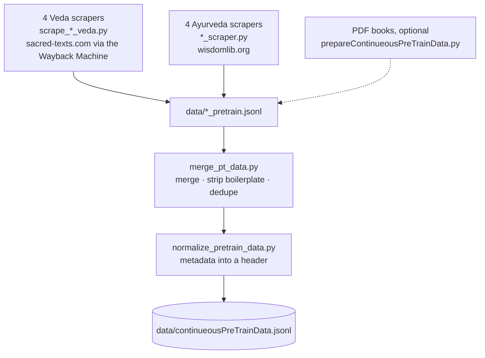
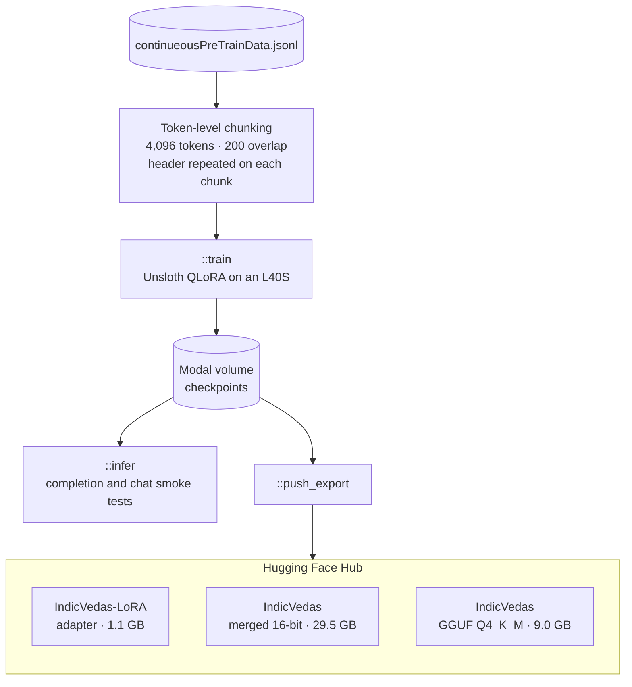
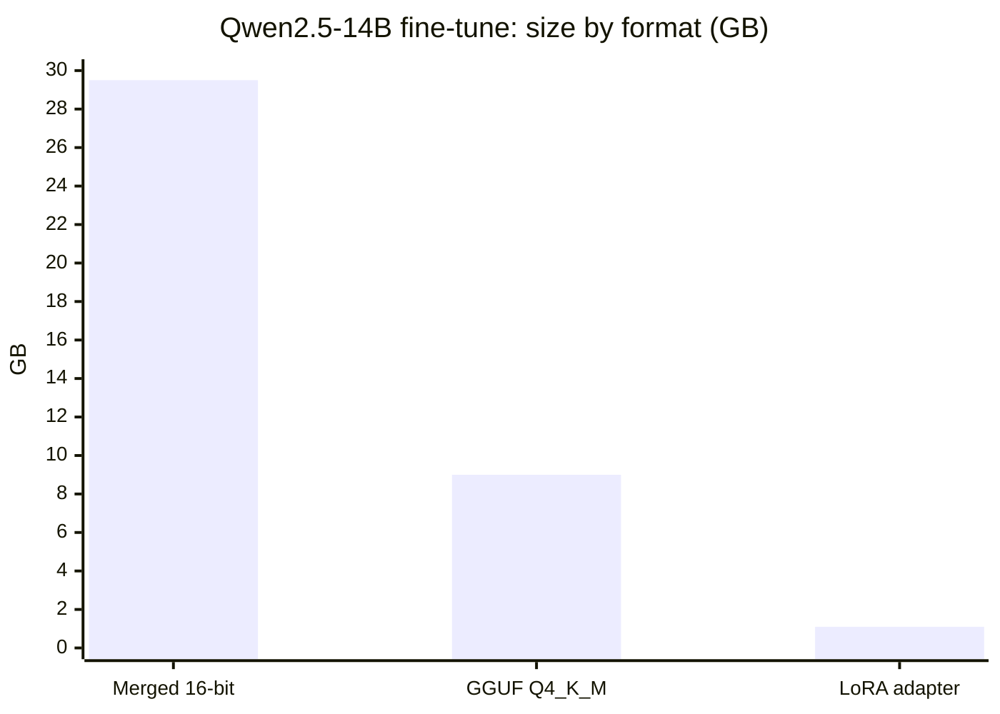
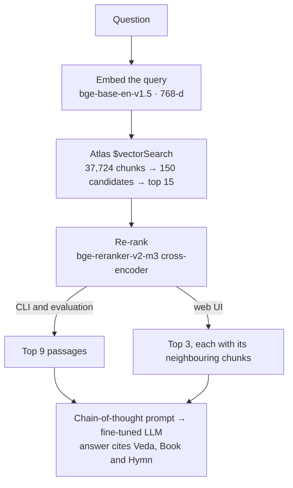
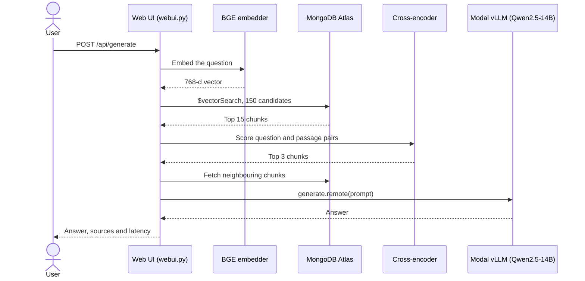
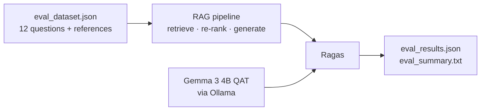

<div align="center">

# 🪶 RishiAI

**Domain-adapted LLMs and retrieval-augmented generation for the Vedas and classical Ayurveda**

[](https://www.python.org/)
[](https://huggingface.co/shinigamiRaj/IndicVedas)
[](https://huggingface.co/datasets/shinigamiRaj/IndianVedasOriginal)
[](https://github.com/unslothai/unsloth)
[](https://modal.com)
[](https://www.mongodb.com/products/platform/atlas-vector-search)

</div>

RishiAI teaches open LLMs the four Vedas and classical Ayurvedic texts. It scrapes and cleans a 10.7M-token corpus, continues pre-training Qwen2.5-14B and Llama-3.2-3B with QLoRA, serves the 14B model with vLLM on Modal, and grounds answers in the source texts through two-stage retrieval over MongoDB Atlas Vector Search. Retrieval and answer quality are measured with Ragas.

## Contents

- [At a glance](#at-a-glance)
- [Architecture](#architecture)
- [Corpus](#corpus)
- [Fine-tuning](#fine-tuning)
- [Serving](#serving)
- [Retrieval-augmented generation](#retrieval-augmented-generation)
- [Evaluation](#evaluation)
- [Getting started](#getting-started)
- [Usage](#usage)
- [Published models and datasets](#published-models-and-datasets)
- [Project structure](#project-structure)
- [Known limitations](#known-limitations)
- [Acknowledgments](#acknowledgments)
- [License](#license)

## At a glance

| | |
|---|---|
| **Corpus** | 7,128 documents · 6.07M words · 10.7M tokens · 4 Vedas and 4 Ayurvedic sources |
| **Models** | Qwen2.5-14B-Instruct (QLoRA, rank 64, ~275M trainable parameters) · Llama-3.2-3B-Instruct (QLoRA, rank 16, 24.3M trainable parameters) |
| **Serving** | vLLM on a Modal L40S (bf16, 16,384-token context) · Q4_K_M GGUF for local use, 70% smaller than the 16-bit weights |
| **Retrieval** | 37,724 chunks · 768-dimensional BGE embeddings · Atlas Vector Search followed by cross-encoder re-ranking |
| **Evaluation** | Ragas context precision, context recall, faithfulness and answer relevancy · 12 curated questions · local Gemma 3 judge |

## Architecture



Each entry point combines a model and a retrieval setup differently:

| Entry point | Script | Generator | Retrieval |
|---|---|---|---|
| Web UI | `continuousPreTrainStyle/webui.py` | Qwen2.5-14B fine-tune on Modal (vLLM) | Atlas, with an in-memory fallback |
| RAG chat | `RAGStyle/rag_inference.py` | Llama-3.2-3B + LoRA, local | Atlas |
| Model chat | `continuousPreTrainStyle/modalinference.py` | Qwen2.5-14B fine-tune on Modal (vLLM) | none |
| Local chat | `continuousPreTrainStyle/inference.py` | Llama-3.2-3B + LoRA, local | none |
| Evaluation | `RAGStyle/evaluate_rag.py` | Llama-3.2-3B + LoRA, judged by Gemma 3 | Atlas |

## Corpus

The corpus pairs Ralph T.H. Griffith's and A.B. Keith's English translations of the four Vedas with three classical Ayurvedic texts and articles from the *International Research Journal of Ayurveda and Yoga* (IRJAY).

| Collection | Translation · source | Documents | Tokens | RAG chunks |
|---|---|---:|---:|---:|
| Rig Veda | R.T.H. Griffith · sacred-texts.com | 1,028 | 487,441 | 1,553 |
| Sama Veda | R.T.H. Griffith · sacred-texts.com | 459 | 89,017 | 496 |
| Yajur Veda | R.T.H. Griffith (White), A.B. Keith (Black) · sacred-texts.com | 2,574 | 545,267 | 3,361 |
| Atharva Veda | R.T.H. Griffith · sacred-texts.com | 724 | 258,440 | 1,156 |
| Charaka Samhita | Shree Gulabkunverba Ayurvedic Society · wisdomlib.org | 143 | 590,254 | 2,057 |
| Sushruta Samhita | Kaviraj Kunja Lal Bhishagratna · wisdomlib.org | 198 | 660,192 | 2,626 |
| Rasa Jala Nidhi | Bhudeb Mookerji · wisdomlib.org | 850 | 405,893 | 1,750 |
| IRJAY articles | wisdomlib.org | 1,152 | 7,660,148 | 24,725 |
| **Total** | | **7,128** | **10,696,652** | **37,724** |

<sub>Tokens are counted with the Llama 3 tokenizer. RAG chunks are what `RAGStyle/ingest_data.py` produces from the published dataset.</sub>





Documents and tokens tell different stories. The Yajur Veda has the most documents because it is stored verse by verse, while the long IRJAY articles supply 72% of all tokens.

### Data pipeline



Scraping follows each text's own structure: hymns (Rig and Atharva Veda), decades and hymns (Sama Veda), anuvakas and verses (Black and White Yajur Veda), and chapters with their sloka context (Ayurveda). PDFs are split into four overlapping chunks per page with 150 characters of overlap. After normalization every document carries its metadata in a header, which also gives the model a prompt format for completion:

```text
[[ Collection: Rig Veda | Translator: Ralph T.H. Griffith | Book: 1 | Hymn: HYMN I | Title: Agni ]]

BOOK I
HYMN I
Agni

1 I Laud Agni, the chosen Priest, God, minister of sacrifice,
The hotar, lavishest of wealth.
2 Worthy is Agni to be praised by living as by ancient seers.
He shall bring hitherward the Gods.
```

## Fine-tuning

Both tracks continue pre-training on raw corpus text: each document, followed by an end-of-sequence token, is a training example. The model learns the language and content of the texts rather than a fixed question-and-answer format.



| | Qwen2.5-14B | Qwen2.5-14B, continued | Llama-3.2-3B |
|---|---|---|---|
| **Script** | `modalFineTune.py` | `modalLORAfineTune.py` | `qloraFineTune.ipynb` |
| **Runs on** | Modal, NVIDIA L40S 48 GB | Modal, NVIDIA L40S 48 GB | Google Colab |
| **Starting point** | `unsloth/Qwen2.5-14B-Instruct-bnb-4bit` | `shinigamiRaj/IndicVedas-LoRA` | `unsloth/Llama-3.2-3B-Instruct-bnb-4bit` |
| **Quantization** | 4-bit NF4 | 4-bit NF4 | 4-bit NF4 |
| **LoRA** | rank 64 · alpha 64 · rsLoRA · all 7 projections | continues the same adapter | rank 16 · alpha 16 · all 7 projections |
| **Trainable parameters** | ~275M (~1.9% of the model) | ~275M | 24.3M |
| **Sequence length** | 4,096 | 4,096 | 2,048 |
| **Effective batch** | 8 (4 × 2 accumulation) | 8 (4 × 2 accumulation) | 8 (2 × 4 accumulation) |
| **Epochs** | 1 | 2 | 1 |
| **Learning rate** | 2e-5, cosine, 50 warm-up steps | 5e-5, cosine, 5% warm-up | 2e-4, 10 warm-up steps |
| **Weight decay** | 0.01 | 0.05, gradient clipping at 1.0 | default |
| **Optimizer** | AdamW 8-bit | AdamW 8-bit | AdamW 8-bit |
| **Data** | 90/10 train/eval split, best checkpoint by eval loss | entire corpus, no eval split | entire corpus |

Checkpoints are saved to a persistent Modal volume, so an interrupted run can be inspected or exported without retraining.

## Serving

The merged 14B model is served by a vLLM engine inside a Modal class. The model loads once per container and stays warm between requests.

| Setting | Value |
|---|---|
| Engine | vLLM 0.8.5 (v0 engine), bf16 |
| Hardware | NVIDIA L40S 48 GB, 2 CPU cores, 32 GiB RAM |
| Context window | 16,384 tokens |
| GPU memory utilization | 0.85 |
| Sampling | temperature 0.2 · top-p 0.9 · repetition penalty 1.15 |
| Weights | `/checkpoints/merged_model` on the Modal volume if present, otherwise `shinigamiRaj/IndicVedas` from the Hub |
| Scaling | scales to zero when idle; the first request afterwards waits for a cold start |

For local use, the same model is exported as a Q4_K_M GGUF that runs in Ollama or LM Studio:



## Retrieval-augmented generation



**Chunking.** Documents of up to 250 words, which covers most hymns, are indexed whole. Longer documents are split on verse numbers into chunks of up to 200 words with 30 words of overlap, falling back to sentence boundaries when there are no verse numbers. Each chunk is embedded together with a metadata prefix such as `Rig Veda | Book 1 | HYMN I | — Agni`, so the vector carries its source.

**Two-stage retrieval.** Vector search gives fast, broad recall. The cross-encoder then reads each question and passage together and re-scores the candidates, which is slower but far more precise than cosine similarity alone.

| Stage | `rag_inference.py`, `evaluate_rag.py` | `webui.py` |
|---|---|---|
| Query embedding | `BAAI/bge-base-en-v1.5` | `BAAI/bge-base-en-v1.5` |
| Vector search | Atlas `$vectorSearch`, 150 candidates, top 15 | same, with an in-memory cosine fallback |
| Re-ranking | `BAAI/bge-reranker-v2-m3`, top 9 | `BAAI/bge-reranker-v2-m3`, top 3 |
| Context expansion | none | each hit plus one chunk before and after |
| Generator | Llama-3.2-3B + LoRA, local | Qwen2.5-14B fine-tune on Modal |
| Max new tokens | 1,500 | 1,500 |

A web UI request flows like this:



## Evaluation

`RAGStyle/evaluate_rag.py` runs the full RAG pipeline over 12 curated questions, each with a reference answer and reference passages, then scores the results with [Ragas](https://github.com/explodinggradients/ragas). A local Gemma 3 model acts as the judge through Ollama's OpenAI-compatible API, so no paid API key is needed.



| Metric | What it measures |
|---|---|
| Context precision | Whether the retrieved passages are relevant to the question |
| Context recall | Whether retrieval found everything the reference answer needs |
| Faithfulness | Whether the answer is supported by the retrieved passages |
| Answer relevancy | Whether the answer addresses the question |

## Getting started

### Requirements

| To run | You need |
|---|---|
| Data pipeline | Python 3.10+ |
| Local chat (`inference.py`, `rag_inference.py`) | An NVIDIA GPU with 4 GB+ of VRAM is recommended (the model loads in 4-bit). On CPU it loads in bf16, needs about 8 GB of free RAM, and is slow. |
| Fine-tuning, Modal chat, web UI | A [Modal](https://modal.com) account (L40S GPU) |
| RAG | A [MongoDB Atlas](https://www.mongodb.com/atlas) cluster with Vector Search |
| Evaluation | [Ollama](https://ollama.com) with `gemma3:4b-it-qat` |

### Install

```bash
git clone https://github.com/raj-gupta1/Vedas.git RishiAI
cd RishiAI
python -m venv .venv
source .venv/bin/activate          # Windows: .venv\Scripts\activate
pip install -r requirements.txt modal beautifulsoup4
```

On Windows, `pip` installs a CPU-only PyTorch. For GPU inference, install a CUDA build from [pytorch.org](https://pytorch.org/get-started/locally/) first.

### Configure

Create a `.env` file in the repository root. The RAG scripts and web UI read it, and the Modal scripts upload it to Modal as a secret.

```env
MONGODB_URI=mongodb+srv://<user>:<password>@<cluster>.mongodb.net/
HF_TOKEN=hf_xxxxxxxx
```

`HF_TOKEN` is only needed to push models to the Hub. Then sign in to Modal:

```bash
modal token new
```

### Download the corpus and adapter

```bash
# Corpus (7,128 documents) for RAG ingestion and fine-tuning
hf download shinigamiRaj/IndianVedasOriginal continueousPreTrainData.jsonl --repo-type dataset --local-dir continuousPreTrainStyle/data

# LoRA weights for the local Llama-3.2-3B model
hf download shinigamiRaj/Vedas-Llama-3.2-3B-LoRA adapter_model.safetensors --local-dir continuousPreTrainStyle/lora_model
```

### Create the Atlas vector index

In your Atlas cluster, create the database `vedic_rag`, the collection `scriptures`, and an Atlas Vector Search index named `vedic_index`:

```json
{
  "fields": [
    { "type": "vector", "path": "embedding", "numDimensions": 768, "similarity": "cosine" }
  ]
}
```

## Usage

### Rebuild the corpus (optional)

The published dataset is already built. To rebuild it from the sources:

```bash
python continuousPreTrainStyle/scrape_rig_veda.py        # resumable; about 10 s per hymn
python continuousPreTrainStyle/scrape_sama_veda.py
python continuousPreTrainStyle/scrape_yajur_veda.py
python continuousPreTrainStyle/scrape_atharva_veda.py
python continuousPreTrainStyle/charaka_scraper.py
python continuousPreTrainStyle/sushruta_scraper.py
python continuousPreTrainStyle/rasa_jala_nidhi_scraper.py
python continuousPreTrainStyle/irjay_scraper.py
python continuousPreTrainStyle/merge_pt_data.py
python continuousPreTrainStyle/normalize_pretrain_data.py
```

The Ayurveda scrapers accept `--delay` and `--output`; all except the Charaka scraper also accept `--limit` for quick test runs. To add a PDF, set `PDF_PATH` in `prepareContinueousPreTrainData.py` and save its output as `continuousPreTrainStyle/data/<name>_pretrain.jsonl` so the merge step picks it up.

### Fine-tune

```bash
modal run --detach continuousPreTrainStyle/modalFineTune.py::train        # QLoRA on an L40S
modal run continuousPreTrainStyle/modalFineTune.py::infer                 # smoke-test the adapter
modal run --detach continuousPreTrainStyle/modalFineTune.py::push_export  # push LoRA, merged 16-bit and GGUF
```

To keep training the published adapter, run `modalLORAfineTune.py::train` instead. The training image bundles `continuousPreTrainStyle/data/continueousPreTrainData.jsonl`, so download or build the corpus first. Hub repositories for the export are set in `push_and_export_remote()`.

For the Llama-3.2-3B track, open `continuousPreTrainStyle/qloraFineTune.ipynb` in Colab with `continueousPreTrainData.jsonl` in `MyDrive/VedasFineTune/`.

### Chat with the model

```bash
modal run -q continuousPreTrainStyle/modalinference.py                            # interactive, vLLM on Modal
modal run continuousPreTrainStyle/modalinference.py --prompt "What are the four Vedas?"
modal run continuousPreTrainStyle/modalinference.py --test                        # built-in test questions
modal run continuousPreTrainStyle/modalinference.py --mode completion             # raw text completion
python continuousPreTrainStyle/inference.py                                       # local Llama-3.2-3B + LoRA
ollama run hf.co/shinigamiRaj/IndicVedas:Q4_K_M                                   # local GGUF, about 9 GB
```

### Retrieval-augmented chat

```bash
python RAGStyle/ingest_data.py      # chunk, embed and upload 37,724 documents
python RAGStyle/rag_inference.py    # interactive RAG chat with the local 3B model
```

`ingest_data.py` drops the existing `scriptures` collection before uploading.

### Web UI

```bash
modal deploy continuousPreTrainStyle/modalinference.py    # deploy the vLLM backend once
python continuousPreTrainStyle/webui.py                   # then open http://localhost:8080
```

Retrieval is enabled automatically when `MONGODB_URI` connects; otherwise the UI answers from the model alone. Each answer lists its sources with their re-ranking scores, and `GET /api/health` reports the backend and database status.

### Evaluate

```bash
ollama pull gemma3:4b-it-qat
pip install "ragas==0.4.3" "langchain-community<0.4" pillow
python RAGStyle/evaluate_rag.py
```

Per-question scores are written to `RAGStyle/eval_results.json` and averages to `RAGStyle/eval_summary.txt`.

### Docker

```bash
docker build -t rishiai .
docker run -it --env-file .env rishiai
```

The image runs the interactive RAG chat (`RAGStyle/rag_inference.py`). Download the LoRA weights before building, and add a `.dockerignore` that lists `.env` and `.venv` so your secrets are not copied into the image.

## Published models and datasets

| Hub repository | Contents | Size |
|---|---|---|
| [shinigamiRaj/IndicVedas](https://huggingface.co/shinigamiRaj/IndicVedas) | Qwen2.5-14B fine-tune: merged 16-bit weights and a Q4_K_M GGUF | 29.5 GB + 9.0 GB |
| [shinigamiRaj/IndicVedas-LoRA](https://huggingface.co/shinigamiRaj/IndicVedas-LoRA) | Qwen2.5-14B LoRA adapter (rank 64) | 1.1 GB |
| [shinigamiRaj/Vedas-Llama-3.2-3B-Merged](https://huggingface.co/shinigamiRaj/Vedas-Llama-3.2-3B-Merged) | Llama-3.2-3B fine-tune, merged | 6.4 GB |
| [shinigamiRaj/Vedas-Llama-3.2-3B-LoRA](https://huggingface.co/shinigamiRaj/Vedas-Llama-3.2-3B-LoRA) | Llama-3.2-3B LoRA adapter (rank 16) | 97 MB |
| [shinigamiRaj/IndianVedasOriginal](https://huggingface.co/datasets/shinigamiRaj/IndianVedasOriginal) | Full normalized corpus, 7,128 documents | 39.5 MB |
| [shinigamiRaj/4VedasEnglish](https://huggingface.co/datasets/shinigamiRaj/4VedasEnglish) | Scraped Rig, Sama, Yajur and Atharva Veda files | 6.5 MB |
| [shinigamiRaj/AtharvaVedHindiSanskrit](https://huggingface.co/datasets/shinigamiRaj/AtharvaVedHindiSanskrit) | PDF extraction of Dr Ganga Sahay Sharma's Hindi and Sanskrit Atharva Veda (not part of the main corpus) | 6.0 MB |

## Project structure

<details>
<summary>Show the file tree</summary>

```text
RishiAI/
├── continuousPreTrainStyle/
│   ├── data/                            # corpus files (JSONL is git-ignored; see Getting started)
│   │   └── README.md                    # dataset card
│   ├── frontend/index.html              # chat interface served by webui.py
│   ├── lora_model/                      # Llama-3.2-3B adapter config and tokenizer (weights downloaded separately)
│   ├── scrape_rig_veda.py               # Veda scrapers: sacred-texts.com via the Wayback Machine
│   ├── scrape_sama_veda.py
│   ├── scrape_yajur_veda.py
│   ├── scrape_atharva_veda.py
│   ├── charaka_scraper.py               # Ayurveda scrapers: wisdomlib.org
│   ├── sushruta_scraper.py
│   ├── rasa_jala_nidhi_scraper.py
│   ├── irjay_scraper.py
│   ├── prepareContinueousPreTrainData.py  # PDF to overlapping chunks
│   ├── merge_pt_data.py                 # merge, strip boilerplate, dedupe
│   ├── normalize_pretrain_data.py       # move metadata into the [[ header ]]
│   ├── clean_and_split_data.py          # stratified 80/10/10 split
│   ├── splitContinueousPretrainData.py  # random 80/10/10 split for the legacy scripts
│   ├── modalFineTune.py                 # Qwen2.5-14B QLoRA on Modal: train, infer, push_export
│   ├── modalLORAfineTune.py             # continue training the published adapter
│   ├── modalinference.py                # vLLM inference on Modal: CLI and deployable class
│   ├── webui.py                         # local web server: RAG plus the Modal backend
│   ├── inference.py                     # local Transformers + LoRA chat
│   ├── qloraFineTune.ipynb              # Colab: Llama-3.2-3B QLoRA
│   ├── qlorafinetunev2.ipynb            # notebook version of the Modal 14B pipeline
│   ├── fix_hf_config.py                 # patch config.json on the Hub for vLLM
│   ├── finetuneContinueousPretrain.py   # legacy local training
│   └── evaluateContinueousPretrain.py   # legacy local evaluation
├── RAGStyle/
│   ├── ingest_data.py                   # chunk, embed, upload to MongoDB
│   ├── rag_inference.py                 # interactive RAG chat
│   ├── evaluate_rag.py                  # Ragas evaluation
│   ├── eval_dataset.json                # 12 questions with reference answers and passages
│   ├── eval_results.json                # latest per-question scores
│   └── eval_summary.txt                 # latest averages
├── evaluate_all_models.py               # legacy BLEU/ROUGE comparison
├── Dockerfile
└── requirements.txt
```

</details>

## Known limitations

- **Corpus balance.** IRJAY articles provide 72% of the tokens, and the text is English translation throughout; only 15 of the 7,128 documents contain Devanagari.
- **Web UI.** `webui.py` is a single-threaded development server without authentication, so it handles one request at a time. Its RAG prompt uses Llama 3 chat tokens, while the Qwen2.5 model it calls expects ChatML.
- **Atlas free tier.** Stored as BSON arrays of 768 doubles, the 37,724 documents take about 467 MB, close to the 512 MB limit of a free M0 cluster.
- **Vector search.** `rag_inference.py` and `evaluate_rag.py` need Atlas `$vectorSearch`; a local MongoDB only works with the web UI's in-memory fallback.
- **Legacy scripts.** `evaluate_all_models.py` and the two legacy local scripts expect `base_model_local/` and `qaAlpacaStyle/`, which are not included.
- **Windows.** The scripts print emoji, so set `PYTHONUTF8=1` when redirecting their output to a file.

## Acknowledgments

- **Translations:** Ralph T.H. Griffith (Rig, Sama, White Yajur and Atharva Veda), Arthur Berriedale Keith (Black Yajur Veda), Kaviraj Kunja Lal Bhishagratna (Sushruta Samhita), Shree Gulabkunverba Ayurvedic Society (Charaka Samhita), Bhudeb Mookerji (Rasa Jala Nidhi), and Dr Ganga Sahay Sharma (Hindi and Sanskrit Atharva Veda).
- **Sources:** [sacred-texts.com](https://sacred-texts.com) through the [Internet Archive](https://web.archive.org), and [wisdomlib.org](https://www.wisdomlib.org).
- **Models:** [Qwen2.5](https://huggingface.co/Qwen/Qwen2.5-14B-Instruct), [Llama 3.2](https://huggingface.co/meta-llama/Llama-3.2-3B-Instruct), [BGE](https://huggingface.co/BAAI/bge-base-en-v1.5) and [BGE re-ranker](https://huggingface.co/BAAI/bge-reranker-v2-m3), and [Gemma 3](https://ollama.com/library/gemma3) as the evaluation judge. Built with Llama.
- **Tools:** [Unsloth](https://github.com/unslothai/unsloth), [Hugging Face](https://huggingface.co), [Modal](https://modal.com), [vLLM](https://github.com/vllm-project/vllm), [MongoDB Atlas](https://www.mongodb.com/atlas), [Ragas](https://github.com/explodinggradients/ragas) and [Ollama](https://ollama.com).

## License

This repository does not include a license yet, so all rights are reserved by default. Fine-tuned weights are also subject to their base models' licenses: Apache 2.0 for Qwen2.5-14B-Instruct and the Llama 3.2 Community License for Llama-3.2-3B-Instruct.
